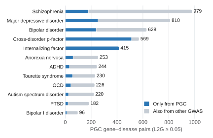
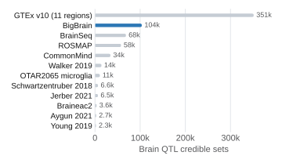

<!-- _class: status -->

# Brain & Mind: new datasets for the Platform

## Two sources ready for the PPP 26.12 run, three in the pipeline

<table>
<thead>
<tr><th>Dataset</th><th>Status</th><th>Biosamples</th><th>Genes</th><th>Diseases</th><th>Next</th></tr>
</thead>
<tbody>
<tr>
<td><strong>BigBrain</strong> eQTL + sQTL#4462 · 104k credible sets</td>
<td>Ready</td>
<td>Bulk brainn = 10.7k, EUR</td>
<td class="num"><strong>19.2k</strong> genes4.0k new to brain QTLs</td>
<td class="na">n/a (molQTL)</td>
<td>In the PPP 26.12 run</td>
</tr>
<tr>
<td><strong>PGC</strong> psychiatric GWAS#4580 · 3,854 credible sets</td>
<td>Ready</td>
<td class="na">n/a (GWAS)</td>
<td class="num"><strong>2.0k</strong> L2G genes5.0k gene–disease pairs</td>
<td><strong>27</strong> diseaseswith credible sets · 47 mapped</td>
<td>In the PPP 26.12 run. 41 GWAS Catalog studies to replace</td>
</tr>
<tr>
<td><strong>PsychAD</strong> single-cell eQTLvia eQTL Catalogue · 34 datasets</td>
<td>Pending upstream</td>
<td><strong>26</strong> cell subtypes8 classes · 373–1,655 donors</td>
<td class="na">After ingestion</td>
<td class="na">n/a (molQTL)</td>
<td>Comes in with the next eQTL Catalogue release</td>
</tr>
<tr>
<td><strong>PsychENCODE</strong> molQTL#4564 · not in eQTL Catalogue</td>
<td>Blocked</td>
<td>Brain, incl. fetal</td>
<td class="na">Scope TBD</td>
<td class="na">n/a (molQTL)</td>
<td>Licence answer from the fetal dataset authors, then our own ingestion</td>
</tr>
<tr>
<td><strong>CSF proteomics</strong> pQTL#4461 · GWAS Catalog pQTLs</td>
<td>To decide</td>
<td>CSF</td>
<td class="na">Scope TBD</td>
<td class="na">n/a (pQTL)</td>
<td>Decide if CSF belongs in the mental-disorders scope</td>
</tr>
</tbody>
</table>

---

<!-- _class: coverage -->

# What the new data covers

## PPP 26.12 run (ppp-2612-1), after validation

<h3>PGC: L2G gene–disease pairs, top 12 psychiatric diseases</h3>

5,034 pairs, 1,998 genes · <b>1,933 pairs found by no other GWAS</b> · 28% of psychiatric GWAS credible sets

<h3>BigBrain: genes with a brain credible set</h3>

Bulk brain (UBERON_0000955) · 41k eQTL + 62k sQTL credible sets

<b>16,325</b>eQTL genes

<b>8,187</b>sQTL genes

<b>+3,986</b>new to brain QTLs

<h3>BigBrain is the 2nd largest brain QTL source</h3>

Brain QTL genes in the run: 22,019 → <b>26,005</b> with BigBrain

